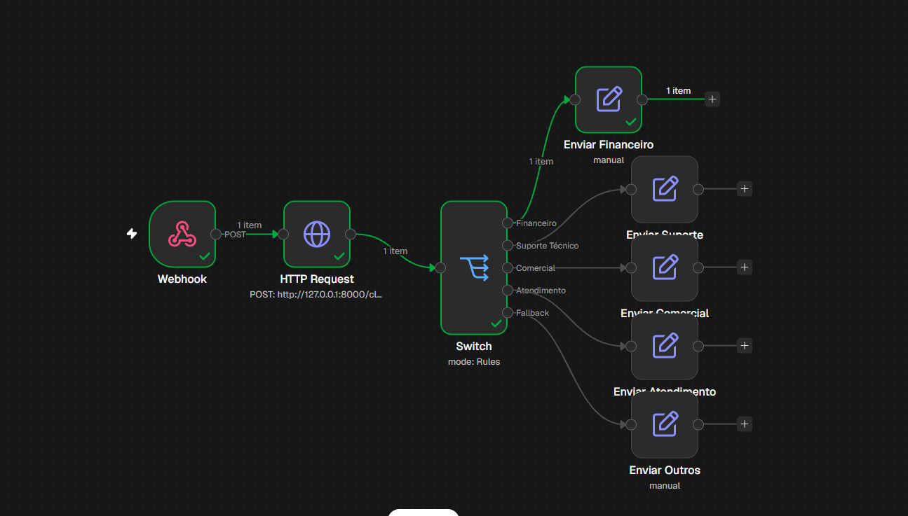
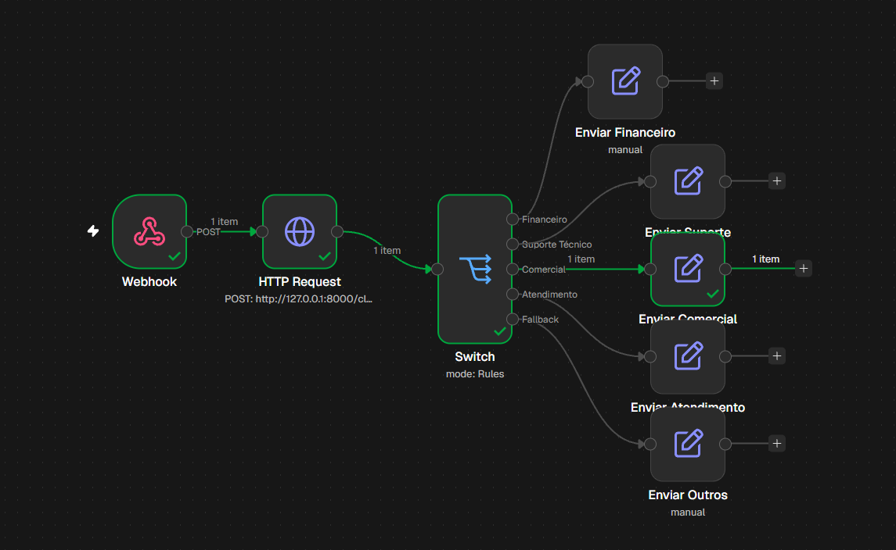
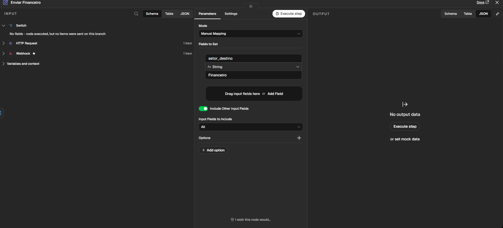
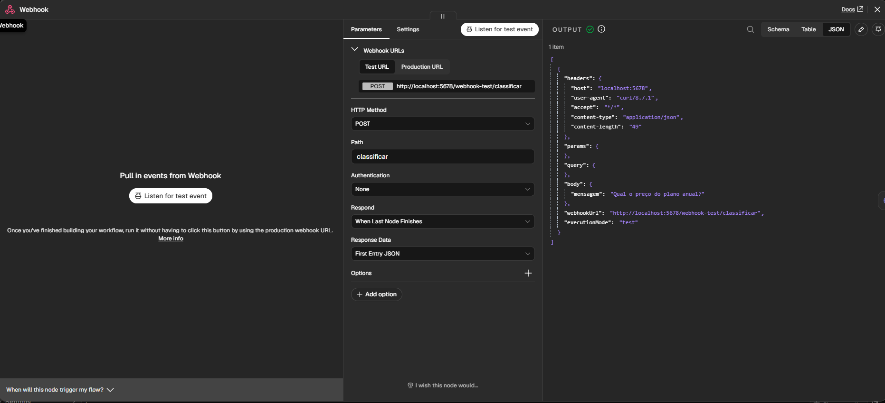
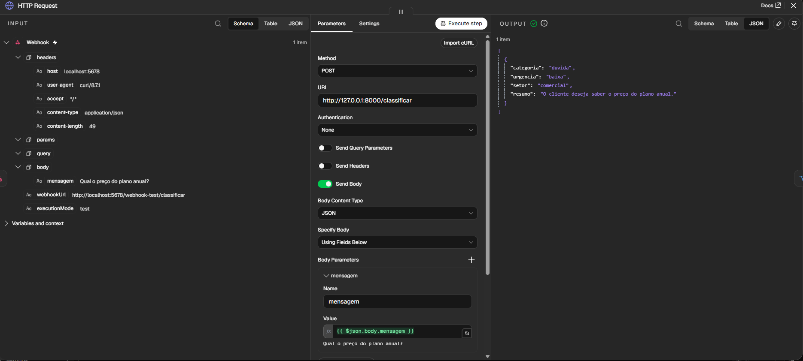
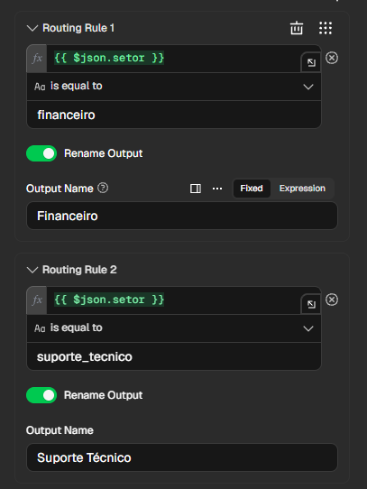
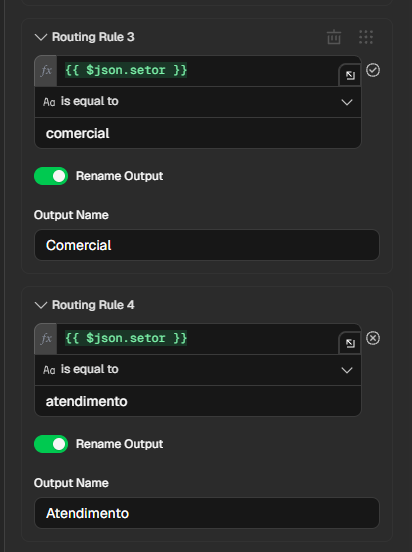
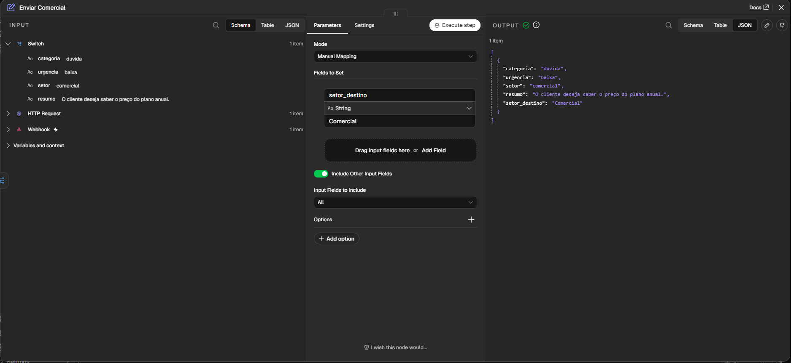
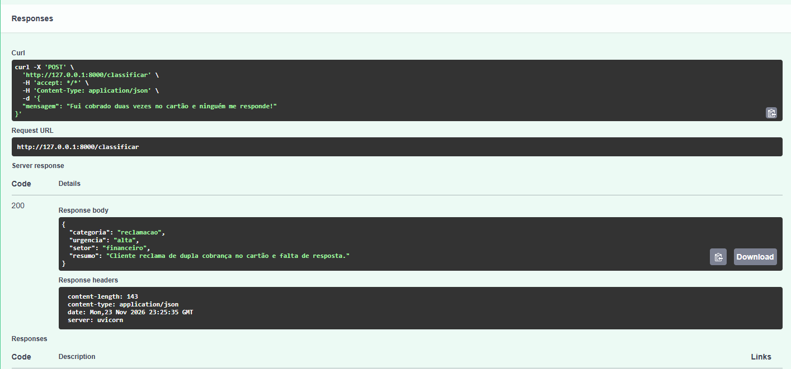

# Classificador de Mensagens com IA e Automação

Projeto integrador (Desafio Técnico KODIE — IA e Automação): uma API em FastAPI que usa IA para classificar mensagens de clientes, integrada a um fluxo de automação no n8n que encaminha cada mensagem para o setor responsável.

## 1. Apresentação da Ideia

A ideia surgiu do cenário proposto no desafio: uma pequena empresa recebe diariamente mensagens de clientes (dúvidas, reclamações, pedidos) e uma pessoa precisa ler cada uma, identificar o assunto e encaminhá-la manualmente. Esse trabalho é repetitivo, consome tempo e dificulta a organização dos atendimentos. A proposta é deixar a IA interpretar a mensagem e a automação cuidar do encaminhamento.

## 2. Problema Escolhido

**Caso 4.1 — Classificação de Mensagens.** A empresa não tem um processo organizado para identificar o assunto de cada mensagem. A solução precisa:

- identificar o tipo da mensagem (dúvida, reclamação, solicitação, elogio ou outro);
- avaliar a urgência;
- definir o setor responsável;
- gerar um resumo curto;
- encaminhar automaticamente a mensagem ao setor correto.

## 3. Solução Proposta

Um fluxo no n8n recebe a mensagem por webhook e a envia para a API. A API monta um prompt estruturado, consulta um modelo de IA (Google Gemini) e valida a resposta em JSON. O n8n usa o campo `setor` da resposta para encaminhar a mensagem pelo caminho certo.

A IA participa de duas formas: **interpreta** o texto livre do cliente e **decide** a categoria, a urgência e o setor, devolvendo tudo em um formato que a automação consegue usar.

Exemplo de resposta da API:

```json
{
  "categoria": "reclamacao",
  "urgencia": "alta",
  "setor": "financeiro",
  "resumo": "Cliente reclama de dupla cobrança no cartão e falta de resposta."
}
```

| Campo | Valores possíveis |
|---|---|
| `categoria` | `duvida`, `reclamacao`, `solicitacao`, `elogio`, `outro` |
| `urgencia` | `baixa`, `media`, `alta` |
| `setor` | `atendimento`, `financeiro`, `suporte_tecnico`, `comercial`, `outros` |
| `resumo` | texto de até 300 caracteres |

## 4. Tecnologias Utilizadas

- **Python** e **FastAPI** (API) com **Uvicorn** (servidor)
- **Pydantic** (validação dos dados de entrada e da resposta da IA)
- **Google Gemini** via biblioteca `google-genai` (modelo configurável por variável de ambiente)
- **n8n** (automação), executado localmente com `npx n8n`
- **python-dotenv** (variáveis de ambiente)
- **Git** e **GitHub**

## 5. Funcionamento do Sistema

1. **Entrada:** o node **Webhook** do n8n recebe um `POST` em `/webhook/classificar` com o corpo `{"mensagem": "..."}`.
2. **Chamada à API:** o node **HTTP Request** envia a mensagem para `POST http://127.0.0.1:8000/classificar`.
3. **Processamento pela IA:** a API valida a entrada (3 a 5000 caracteres), monta o prompt e chama o Gemini.
   - O prompt define as categorias fixas e exige resposta **somente em JSON**.
   - O conteúdo da mensagem é tratado como dado, e instruções contidas nele são ignoradas (proteção contra prompt injection).
4. **Validação:** a resposta é convertida em JSON e validada com Pydantic (`Literal` rejeita qualquer valor fora da lista). Se a IA responder fora do formato, a API tenta de novo.
5. **Resiliência:** em erros temporários do provedor (503 e 429), a API tenta até 4 vezes com espera crescente. Se ainda falhar, devolve erro 502 com a descrição.
6. **Encaminhamento:** o node **Switch** lê o campo `setor` e envia o item para uma das saídas: Financeiro, Suporte Técnico, Comercial, Atendimento ou Fallback (`outros`).
7. **Destino:** em cada saída, um node **Edit Fields** adiciona o campo `setor_destino` e mantém os demais dados. Esse ponto pode ser trocado por e-mail, Telegram, Slack ou Google Sheets.
8. **Resposta:** o webhook devolve ao chamador o JSON final com a classificação e o `setor_destino`.

### Endpoints da API

| Método | Rota | Descrição |
|---|---|---|
| `GET` | `/health` | Verifica se a API está no ar |
| `POST` | `/classificar` | Classifica uma mensagem |
| `GET` | `/docs` | Documentação interativa (Swagger) |

## 6. Como Executar

### Pré-requisitos

- Python 3.9 ou superior
- Node.js 20 ou superior (para o n8n)
- Uma chave de API do Google AI Studio (https://aistudio.google.com/apikey)

### 1) Configurar e iniciar a API

```bash
python -m venv .venv
source .venv/Scripts/activate      # Windows (Git Bash). Linux/Mac: source .venv/bin/activate
pip install -r requirements.txt
cp .env.example .env               # edite o .env e coloque sua GEMINI_API_KEY
uvicorn main:app --reload
```

A API fica em `http://127.0.0.1:8000`. Teste em `http://127.0.0.1:8000/docs`.

Variáveis de ambiente (`.env`):

| Variável | Descrição |
|---|---|
| `GEMINI_API_KEY` | Chave de API do Google AI Studio |
| `AI_MODEL` | Modelo usado (ex.: `gemini-3.5-flash-lite`) |

> Nunca envie o arquivo `.env` ao repositório. Ele já está no `.gitignore`.

### 2) Iniciar o n8n

Em outro terminal:

```bash
npx n8n
```

Abra `http://localhost:5678` e crie a conta local.

### 3) Importar o fluxo

1. No n8n, crie um workflow novo.
2. Menu **⋯ → Import → From file** e selecione `fluxo-n8n/workflow.json`.
3. Confira que o HTTP Request aponta para `http://127.0.0.1:8000/classificar`.

### 4) Testar

**Modo de teste:** clique em **Execute workflow** e, logo em seguida, envie:

```bash
curl -s -X POST http://localhost:5678/webhook-test/classificar \
  -H "Content-Type: application/json" \
  -d '{"mensagem": "Fui cobrado duas vezes no cartao e ninguem me responde!"}'
```

O modo de teste aceita uma chamada por clique em **Execute workflow**.

**Modo produção:** publique o workflow e use `http://localhost:5678/webhook/classificar`.

Resposta esperada (exemplo):

```json
{"categoria":"reclamacao","urgencia":"alta","setor":"financeiro","resumo":"...","setor_destino":"Financeiro"}
```

## Documentação do Fluxo de Automação

Os prints ficam na pasta `docs/prints/`.

### Fluxo completo



Webhook → HTTP Request → Switch → cinco destinos (Edit Fields).

### Execuções bem-sucedidas




Três mensagens diferentes percorrendo caminhos diferentes do fluxo.

### Configuração dos nodes

| Node | Função | Print |
|---|---|---|
| Webhook | Recebe a mensagem por `POST` no path `classificar` e responde ao final do fluxo |  |
| HTTP Request | Envia a mensagem para a API e recebe a classificação |  |
| Switch | Encaminha pelo campo `setor`, com saída de fallback para `outros` |   |
| Edit Fields | Marca o destino (`setor_destino`) mantendo os demais campos |  |

### API funcionando



## Estrutura do Repositório

```
.
├── main.py                  # API FastAPI
├── requirements.txt
├── .env.example             # nomes das variáveis (sem valores reais)
├── .gitignore
├── README.md
├── fluxo-n8n/
│   └── workflow.json        # fluxo exportado do n8n
└── docs/
    └── prints/              # capturas de tela do fluxo
```

## Segurança

- A chave de API fica apenas no `.env`, que não é versionado.
- O fluxo do n8n não contém credenciais: ele só chama a API local.
- O `.env.example` traz somente os nomes das variáveis.
